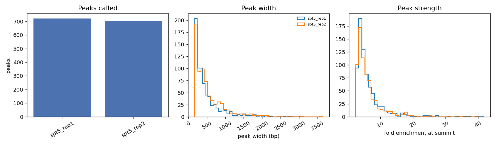
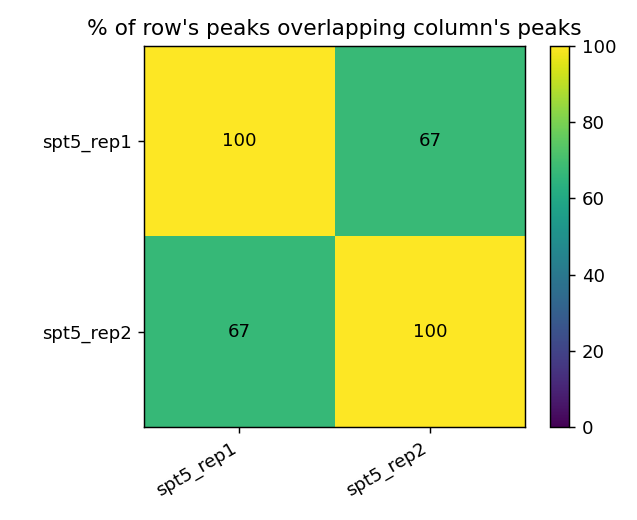

# Bulk ChIP-seq: bowtie2 + MACS3, Input-Controlled Peak Calling

[](https://github.com/syed1789/bulk-chipseq-pipeline/actions/workflows/ci.yml)

**Author:** Syed Nurul Hasan, Ph.D.
**Contact:** nayanchoton1789@gmail.com | [ORCID: 0000-0002-4564-872X](https://orcid.org/0000-0002-4564-872X)

---

## Why this project

My `cutandrun-pipeline` repo covers CUT&Tag/CUT&RUN — a related but distinct
technique from **classical ChIP-seq**, the specific method behind the
genome-wide profiling work in my Ph.D. (Bcl11b/Foxp3 in Tregs, ChIP-seq +
RNA-seq + ATAC-seq, POSTECH). That work had no public repo behind it. This
one closes that gap: crosslink-style ChIP-seq with a matched Input control,
the standard antibody-vs-background design, run end-to-end on real data.

## Pipeline

```
Paired-end FASTQ (Spt5 ChIP x2 reps, matched Input control x2 reps)
        │
        ▼
1. bowtie2_index / bowtie2_align  (Docker: biocontainers/bowtie2)
   --sensitive, end-to-end alignment (not --local, unlike CUT&RUN/CUT&Tag --
   classical ChIP-seq doesn't need the short/permissive local-alignment mode
   those in-situ tethering methods do)
        │
        ▼
2. sort_index_bam  (samtools)
        │
        ▼
3. macs3_callpeak  (Docker: biocontainers/macs3)
   IP vs. matched Input, per replicate, BAMPE mode
        │
        ▼
4. replicate_concordance  (scripts/replicate_concordance.py)
   fraction of each replicate's peaks that overlap the other replicate's
   peaks -- the standard first-line ChIP-seq reproducibility check
```

## Dataset

Paired-end FASTQ (downsampled to 100k read pairs/sample) + the full *S.
cerevisiae* reference genome, from
[nf-core/test-datasets](https://github.com/nf-core/test-datasets)
(`chipseq` branch), derived from **PRJNA315202** — Baejen C, Andreani J,
Torkler P, et al. "Genome-wide Analysis of RNA Polymerase II Termination at
Protein-Coding Genes." *Molecular Cell*. 2017. ChIP target: **Spt5**, a
transcription elongation factor that travels with RNA Pol II through gene
bodies (distinct from a promoter-restricted mark like H3K4me3 — see the
QC note below).

## Results (this run)

- Alignment: **94–98%** overall rate for all 4 samples — the reference here
  is the actual matched genome (not a subset, unlike the CUT&Tag repo's
  chr20-only reference), so mapping rates look like real production numbers.
- MACS3 (`-q 0.05`, BAMPE, effective genome size 1.2e7): **722 peaks**
  (rep1), **701 peaks** (rep2).
- **Replicate concordance: 67.5% / 66.9%** of each replicate's peaks overlap
  a peak in the other replicate — genuinely good reproducibility for a
  100k-read-subsampled test dataset. Full table:
  [`results/replicate_concordance.tsv`](results/replicate_concordance.tsv).
- **A QC check I tried and am reporting honestly because it wasn't
  informative:** I checked what fraction of peak summits fall inside an
  annotated gene body, expecting elongation-factor enrichment there. The
  bundled test annotation (`genes.bed`) only covers 300 of yeast's ~6,000
  genes — 3.27% of the genome by chance — and the observed overlap (3–4%)
  landed right at that chance level. That's a sparse-annotation artifact,
  not a failed ChIP: gene-body enrichment for an elongation factor requires
  a full annotation to detect, which this minimal CI-scale reference
  doesn't provide. Reported instead of quietly dropped.

## Running it

```bash
bash scripts/download_data.sh

python3 -m venv .venv && source .venv/bin/activate
pip install snakemake

snakemake -s workflow/Snakefile --cores 4 -p

# SLURM cluster execution
snakemake -s workflow/Snakefile --workflow-profile workflow/profiles/slurm
```

## Key Features

- Real bowtie2 alignment + MACS3 peak calling, containerized
- Matched Input-control design, the standard classical ChIP-seq convention
  (distinct from CUT&RUN/CUT&Tag's IgG-control local-alignment approach)
- Biological-replicate concordance as the primary QC metric
- A QC check that turned out uninformative is reported and explained, not
  silently dropped

## References

1. Baejen C, Andreani J, Torkler P, et al. Genome-wide Analysis of RNA
   Polymerase II Termination at Protein-Coding Genes. *Molecular Cell*.
   2017;66(1):38-49.e6.
2. Zhang Y, Liu T, Meyer CA, et al. Model-based Analysis of ChIP-Seq
   (MACS). *Genome Biology*. 2008;9:R137.
3. Langmead B, Salzberg SL. Fast gapped-read alignment with Bowtie 2.
   *Nature Methods*. 2012;9(4):357-359.

## License

MIT — see [LICENSE](LICENSE).

## Figures

Generated by `python scripts/make_figures.py` from the MACS3 peak files (SPT5 ChIP-seq, two replicates):





## Running on HPC (SLURM) and AWS

Includes `CONTAINER_RUNTIME=apptainer` switch for the Snakefile, a SLURM head-job script, and a one-shot EC2 launcher. See [HPC_AWS.md](HPC_AWS.md) for steps and what was verified.
